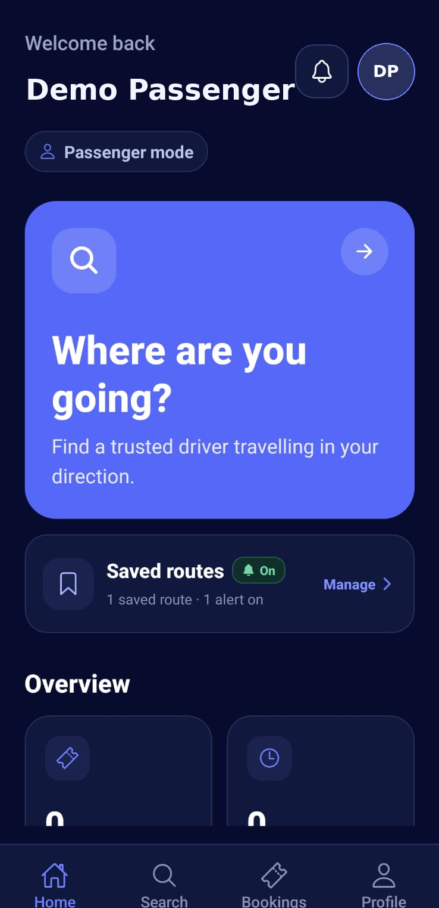
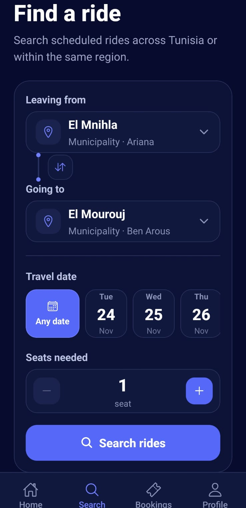
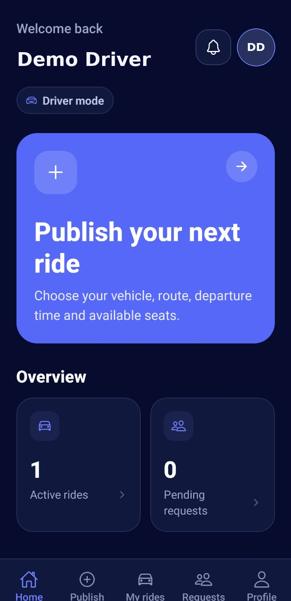
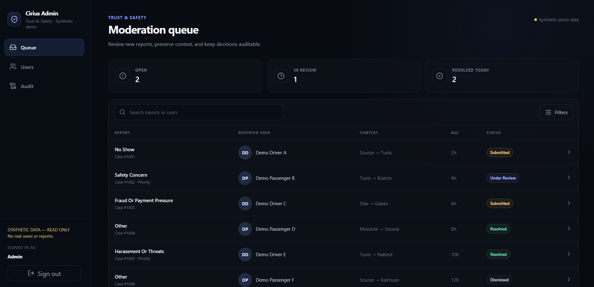
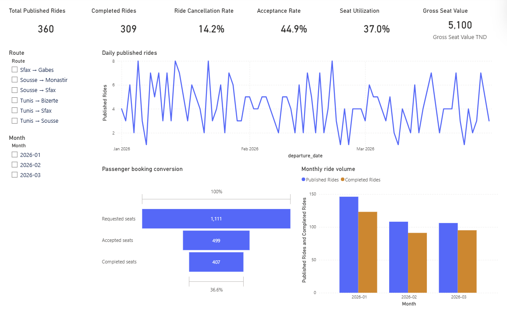

# Cirius | Intercity Mobility & Business Analytics

**Entrepreneurial product case study · Tunisia · Pre-launch**

Cirius is an independently developed intercity carpooling platform designed to connect drivers with spare seats and passengers seeking a more convenient way to travel between Tunisian cities. This portfolio documents product development, business analysis, marketing and analytics without distributing the commercial application source.

**Explore the analytics:** [Power BI dashboards](analytics/README.md#power-bi-dashboard-screenshots) · [Business findings](analytics/insights.md) · [Financial model](business-analysis/financial-model.md) · [Editable report](analytics/power-bi-project/README.md)

## The problem

Intercity travellers must coordinate availability, pickup, luggage, pricing and trust. Drivers also need a clear way to communicate capacity and manage booking requests. Cirius brings those decisions into a structured digital journey.

## The product

| Passenger experience | Driver experience |
|---|---|
| Search for rides and request seats | Publish rides and manage vehicle profiles |
| Agree on pickup and luggage arrangements | Review requests and negotiate pickup arrangements |
| Booking-scoped messaging and ride alerts | Manage seat and luggage availability |
| View shared driver position during eligible active rides | Start and complete rides |
| Rate, report and block participants | Rate, report and block participants |

The project also includes a separate internal moderation interface, profile photos, push notifications, and a localized interface in Tunisian Arabic, French and English.

## Product preview

  
  
  

<b>Passenger dashboard · Ride discovery · Driver dashboard</b>

### Trust and safety operations

Mobile captures are anonymized; admin views contain fictional demonstration data. [Explore all 21 screenshots](screenshots/README.md).

## My contribution

Founder and application developer: product definition, requirements analysis, user journeys, mobile application development, data modelling, business rule design and release planning. The showcase extends this work with an illustrative business intelligence case study and commercial feasibility analysis.

## Explore the portfolio

| Case study | What it demonstrates |
|---|---|
| [Product requirements and processes](product-management/README.md) | Stakeholders, requirements, acceptance criteria |
| [Technical architecture](architecture/README.md) | System design, data integrity, testing |
| [Market and competitor analysis](business-analysis/market.md) | Research, segmentation, TAM/SAM/SOM |
| [Financial scenario model](business-analysis/financial-model.md) | Unit economics, break-even, sensitivity |
| [Analytics lab](analytics/README.md) | Dashboard previews, SQL, DAX, route analysis and recommendations |
| [Marketing measurement plan](marketing/README.md) | Acquisition, activation, retention |
| [Development roadmap](roadmap/README.md) | Completed scope and remaining launch gates |
| [Product gallery](screenshots/README.md) | 21 mobile and admin screenshots |

## Marketplace analytics

[Route performance](analytics/dashboards/02-route-performance.png) · [Pricing and value](analytics/dashboards/03-pricing-and-value.png) · [Analytical findings](analytics/insights.md) · [Power BI project](analytics/power-bi-project/README.md)

## Technology

**Analytics:** Power BI · DAX · SQL (PostgreSQL) · Power Query · CSV · Git/GitHub

**Application:** React Native · Expo · TypeScript · Supabase · PostgreSQL · Vitest · pgTAP

## Status and evidence

The application is in pre-launch development. Core ride, booking, messaging, localization, trust and moderation workflows are documented as implemented; store readiness, final validation and compliance work are separate release gates. No public launch, customer traction, realized revenue or current all-green test result is claimed.

**Data disclosure:** Every metric in the analytics lab and financial scenarios is simulated or hypothetical, not operational Cirius data. Sources and assumptions are identified separately.

**Commercial boundary:** This repository contains original portfolio material and illustrative analysis only. The commercial mobile application and admin implementation remain private. No production credentials, customer information or proprietary source code are included.
