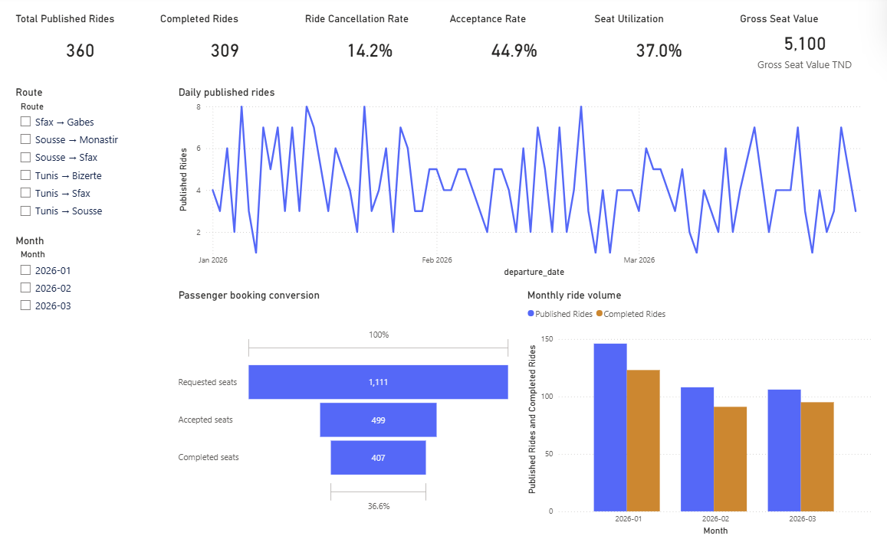
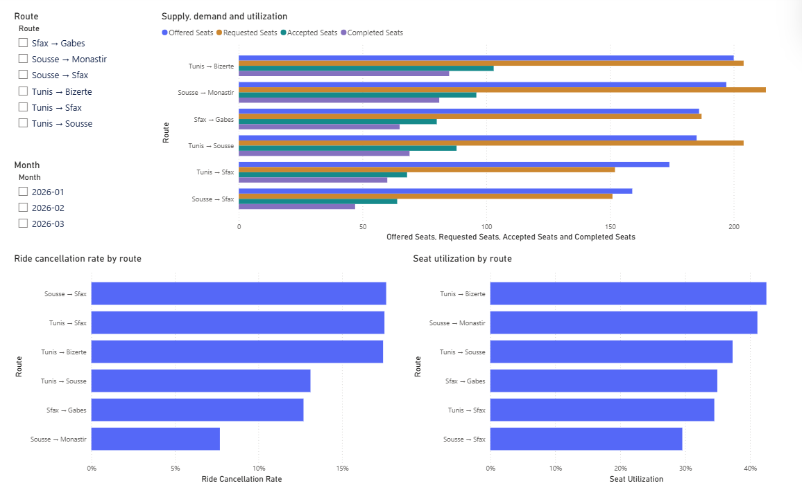
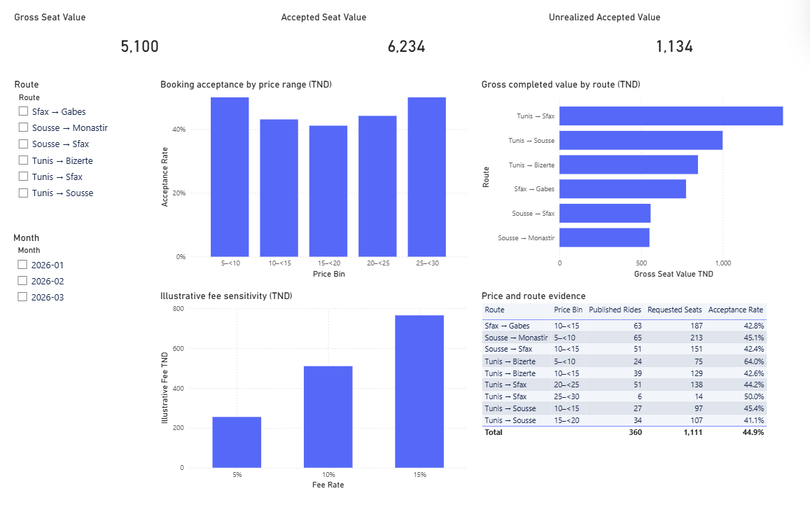

# Business intelligence lab

**100% synthetic data — no actual rides, customers, revenues or traction.**

This lab models a closed historical sample of 360 fictitious rides from January–March 2026. Randomized route, seat demand, capacity, booking acceptance, cancellation and seat completion fields are designed for demonstration only. No personal data is included.

## Deliverables

- [Synthetic dataset](synthetic-rides.csv)
- [Data dictionary and Power BI instructions](power-bi.md)
- [SQL analyses](analysis.sql)
- [Illustrative financial scenarios](../business-analysis/financial-scenarios.csv)

## Reproducible dataset totals

| KPI | Simulated result |
|---|---:|
| Published rides | 360 |
| Completed ride records | 309 |
| Cancelled ride records | 51 |
| Offered seats | 1101 |
| Requested seats | 1111 |
| Accepted seats | 499 |
| Completed seats | 407 |
| Completed seat utilization | 37.0% |
| Accepted / requested seats | 44.9% |
| Completed / accepted seats | 81.6% |
| Gross completed seat value | 5,100 TND |

## Example analytical questions

Which simulated routes have the highest utilization? How much demand remains unaccepted? How does cancellation impact realized seat utilization? Which routes could warrant deeper demand research?

| Route | Synthetic rides | Offered seats | Completed seats | Utilization |
|---|---:|---:|---:|---:|
| Tunis → Bizerte | 63 | 200 | 85 | 42.5% |
| Sousse → Monastir | 65 | 197 | 81 | 41.1% |
| Tunis → Sousse | 61 | 185 | 69 | 37.3% |
| Sfax → Gabes | 63 | 186 | 65 | 34.9% |
| Tunis → Sfax | 57 | 174 | 60 | 34.5% |
| Sousse → Sfax | 51 | 159 | 47 | 29.6% |

The data is at ride grain, not user or booking grain. It cannot support real customer segmentation, CAC or cohort retention. Gross seat value is not platform revenue. An editable Power BI project is provided in PBIP format; all three report pages have been opened and visually checked in Power BI Desktop.

## Power BI dashboard screenshots

[Marketplace overview](dashboards/01-marketplace-overview.png) · [Route performance](dashboards/02-route-performance.png) · [Pricing and value](dashboards/03-pricing-and-value.png)

## Analysis and editable report

- [Business findings and recommendations](insights.md)
- [Power BI project and opening instructions](power-bi-project/README.md)
- [DAX measure library](power-bi-measures.dax)
- [Route metrics CSV](route-metrics.csv) and [price metrics CSV](price-metrics.csv)

The PNG images above are captures of the refined Power BI Desktop report. The original SVG previews remain available in the dashboards directory.
