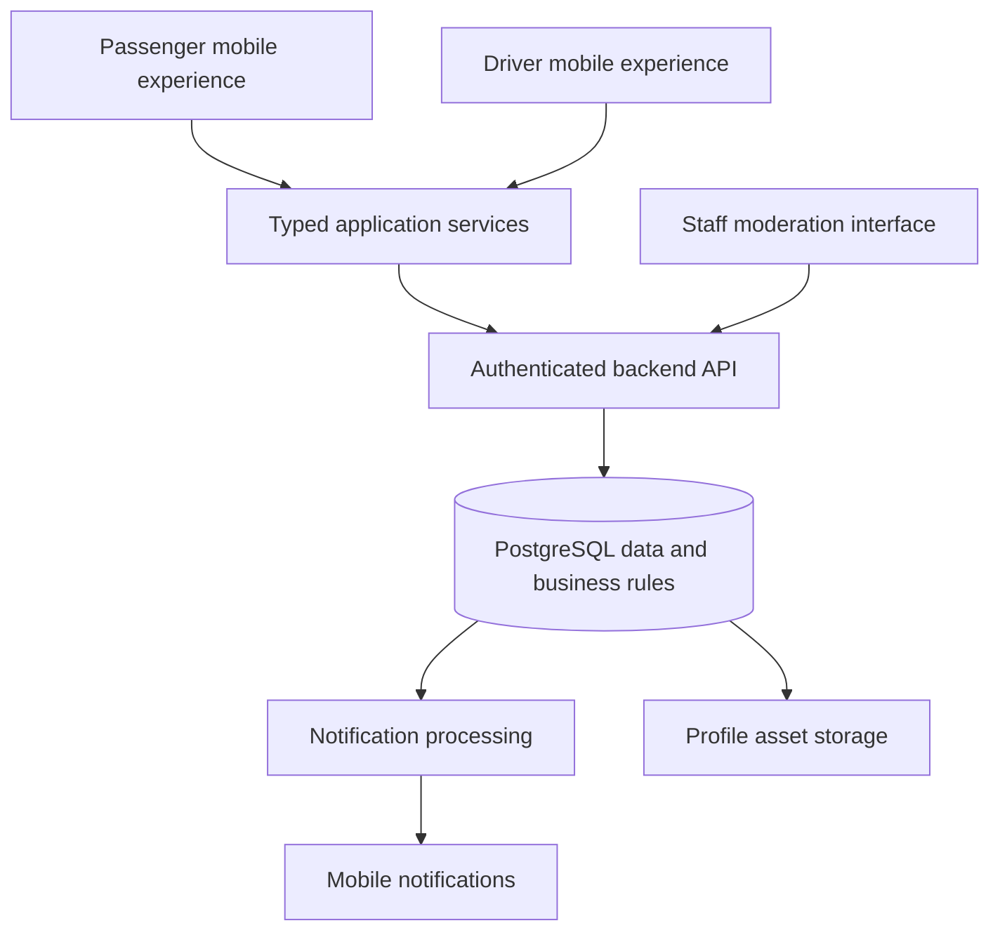

# High-level architecture

Cirius uses a React Native/Expo mobile client, typed TypeScript service boundaries and a Supabase/PostgreSQL backend. A separate staff-facing web interface supports moderation.

## Design decisions

| Decision | Business rationale |
|---|---|
| Explicit ride and booking states | Prevent ambiguous status and improve supportability |
| Server-authoritative capacity checks | Avoid overselling seats under concurrent demand |
| Participant-scoped data access | Reduce unnecessary exposure of ride and personal data |
| Separate moderation workflow | Keep consumer experience distinct from staff operations |
| Localized mobile interface | Support Tunisian Arabic, French and English |
| Isolated regression tests | Protect real users and data while testing complex workflows |

## Quality strategy

- Unit tests for shared business logic and navigation.
- Database contract tests for rules and access boundaries.
- Authenticated integration tests for driver/passenger workflows.
- Concurrency tests for contested capacity and state changes.
- Physical device checks for location, notifications and language layout.

These are documented engineering practices, not a claim that the latest build passes all checks. Detailed schemas, security internals, deployment identifiers and commercial code are intentionally excluded.
