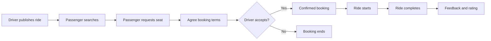

# Product management case study

## Stakeholders and needs

| Stakeholder | Need | Product response |
|---|---|---|
| Passenger | Find an appropriate seat | Search, vehicle information, booking |
| Driver | Fill spare seats without losing control | Ride publishing and request review |
| Both | Resolve pickup and luggage expectations | Structured negotiation and messaging |
| Both | Build confidence in a shared trip | Reputation, reporting and blocking |
| Operations | Review issues consistently | Separate moderation workflow |

## Core journey

## Illustrative acceptance criteria

| Requirement | Given / when / then |
|---|---|
| Capacity integrity | When simultaneous requests compete for the last seat, accepted demand must not exceed capacity. |
| Pickup agreement | When booking terms require agreement, acceptance must respect confirmed terms. |
| Trip lifecycle | When a ride begins, its state changes explicitly and eligible participants can follow progress. |
| Messaging privacy | When a non-participant tries to view a conversation, access must be denied. |
| User safety | When a participant reports or blocks another, the action follows the relevant booking and safety rules. |
| Localization | When a user changes the supported language, interface layout and text reflect that choice. |

## Prioritization

Core marketplace functionality and trust workflows precede growth features. Release readiness is a gate rather than a date commitment. Product decisions balance usability, reliability, safety and commercial viability.
