# Product gallery

[← Back to the project overview](../README.md)

**21 screenshots: 16 mobile captures and 5 admin views.** Cirius is a pre-launch product. The images demonstrate interfaces and workflows, not actual customer traction or operational performance.

## Mobile application

Genuine Android captures from development/testing. Names and profile photos were replaced with demo labels and initials; personal email and specific pickup information were obscured, and system bars were cropped. Some screens retain the earlier development name Cov. Dates, fares and routes are examples from captured screens and do not form one continuous transaction.

### Onboarding and identity

  <a href="mobile/01-login.png">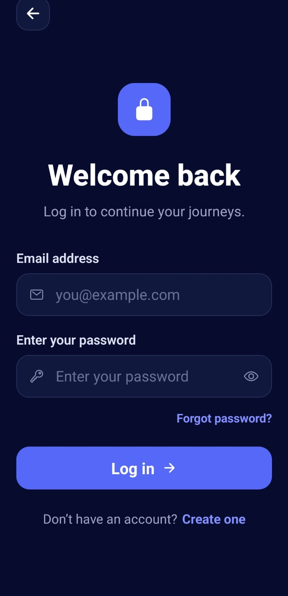</a>
  <a href="mobile/02-profile.png">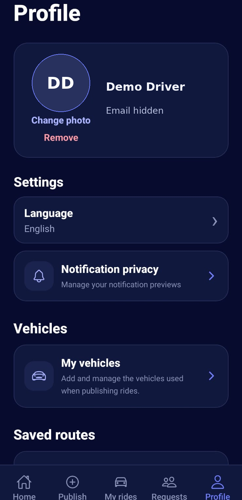</a>
  

Login · Profile settings · Language selection

### Passenger journey

  <a href="mobile/04-passenger-home.png">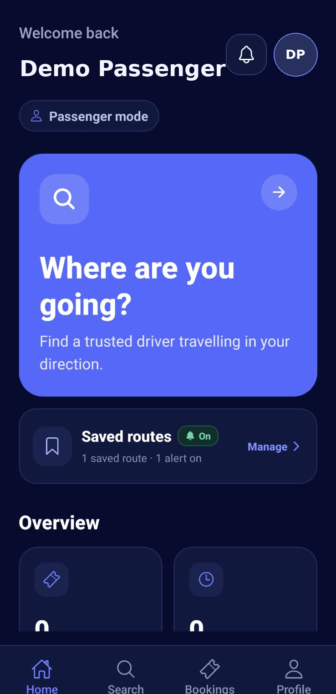</a>
  <a href="mobile/06-ride-search.png">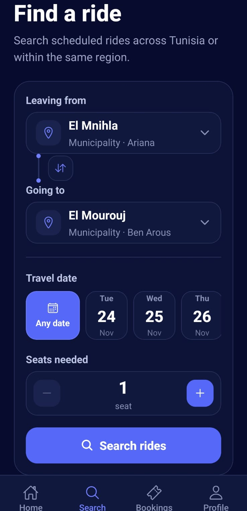</a>
  <a href="mobile/07-ride-results.png">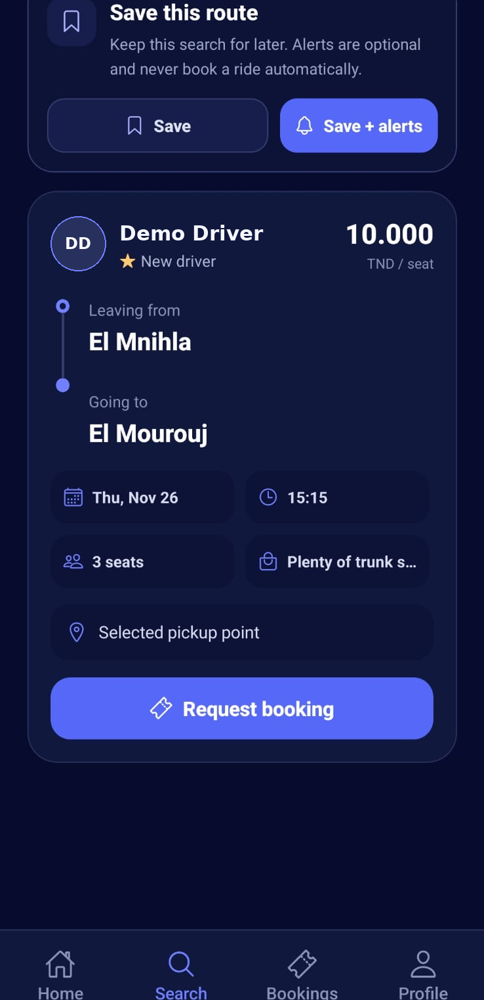</a>

Passenger dashboard · Ride search · Ride results

### Pickup and booking

  <a href="mobile/08-pickup-preferences.png">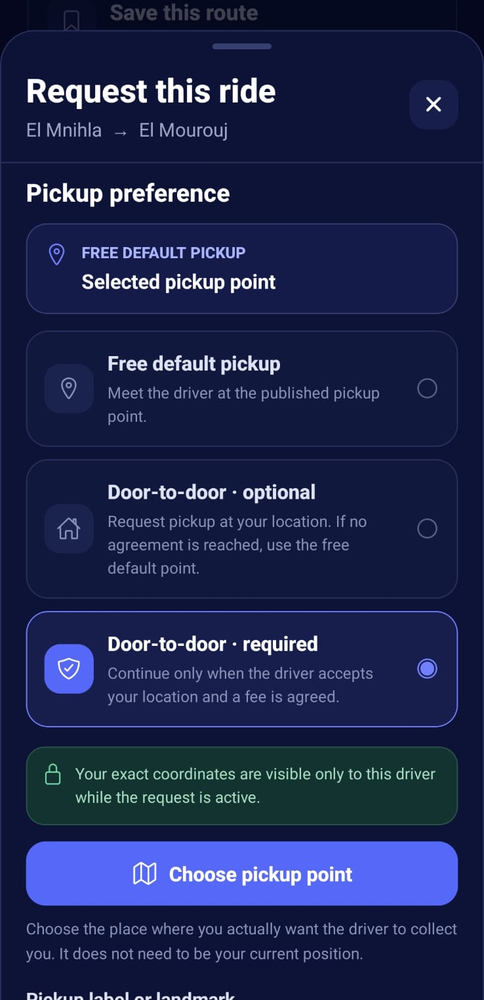</a>
  <a href="mobile/09-pickup-fee.png">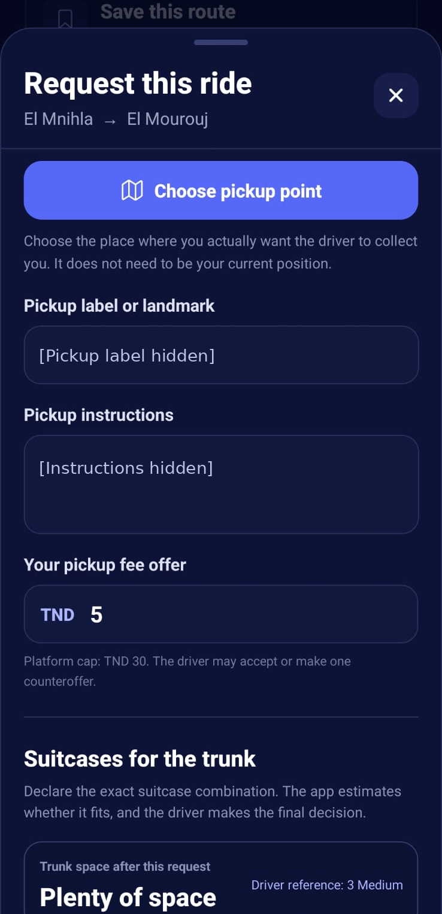</a>
  <a href="mobile/11-confirmed-booking.png">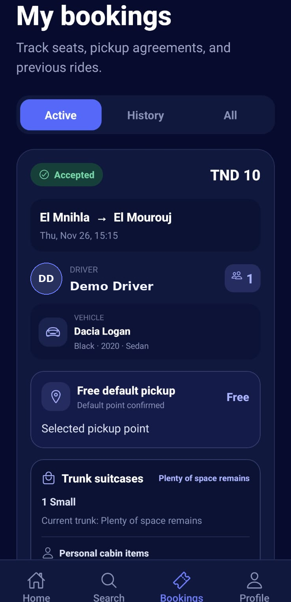</a>

Pickup preferences · Pickup fee offer · Accepted booking

### Communication and retention

  <a href="mobile/10-messaging.png">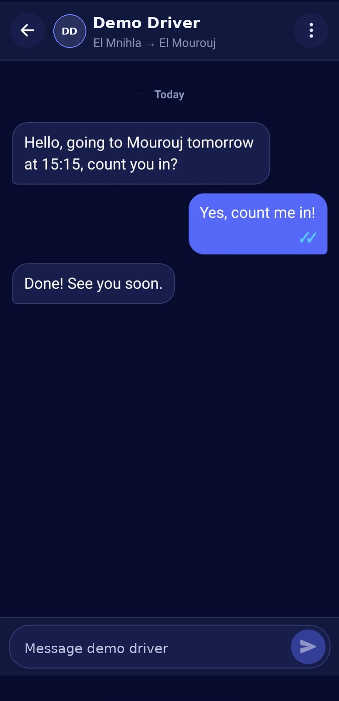</a>
  <a href="mobile/12-saved-routes.png">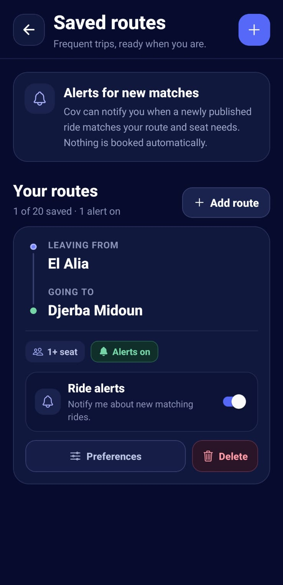</a>

Booking messaging · Saved routes and alerts

### Driver operations

  <a href="mobile/05-driver-home.png">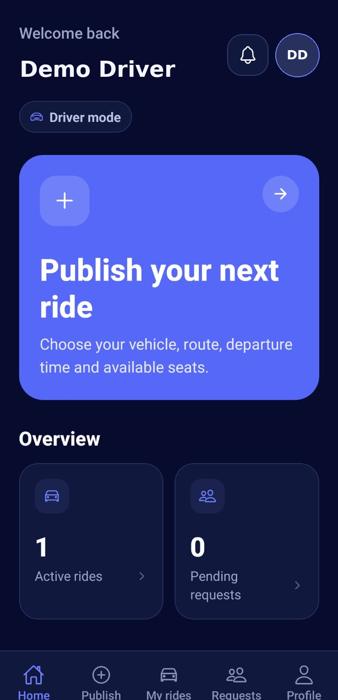</a>
  <a href="mobile/13-vehicles.png">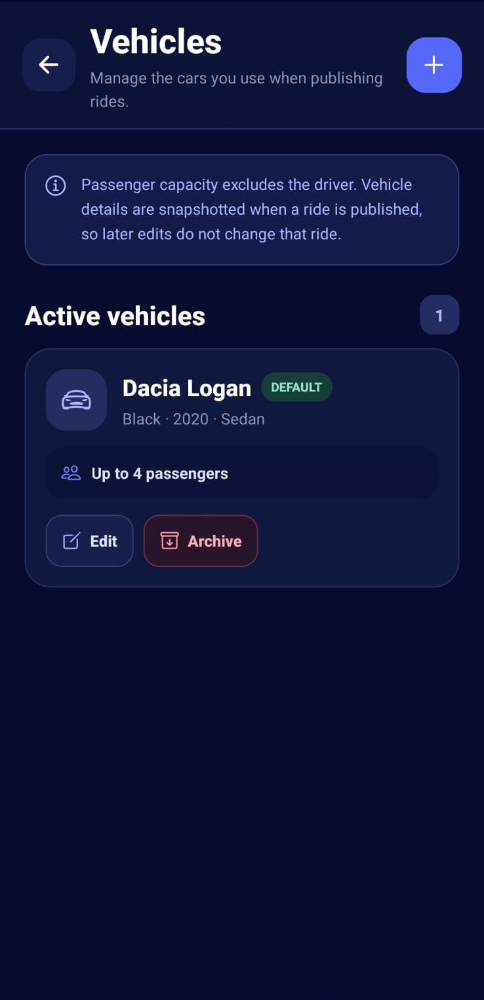</a>
  <a href="mobile/14-add-vehicle.png">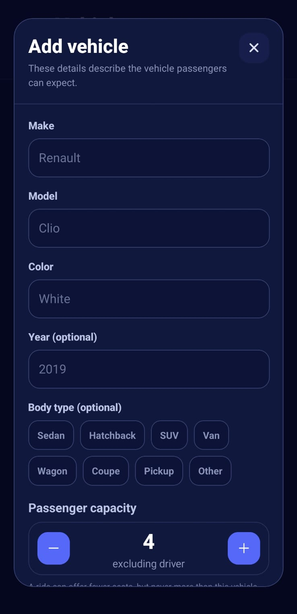</a>

Driver dashboard · Vehicle management · Add a vehicle

### Ride supply and requests

  <a href="mobile/15-publish-ride.png">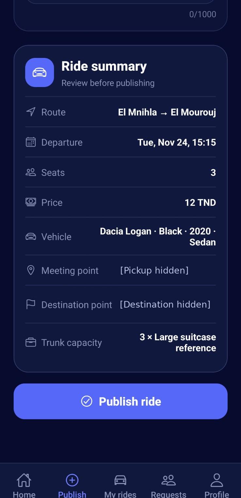</a>
  <a href="mobile/16-booking-requests.png">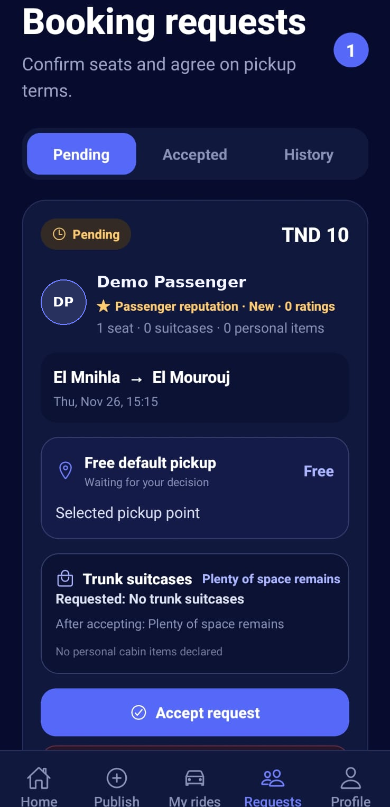</a>

Ride publishing summary · Booking requests

## Administration — trust and safety

The actual admin interface was run in an isolated, read-only demonstration environment with fictional users, reports, ratings and audit entries. No real safety cases are depicted. The queue data-source label and one fictional case description were edited in the images to match corrections made in the demo branch.

### Moderation queue

Case prioritization, report status, search and filters.

[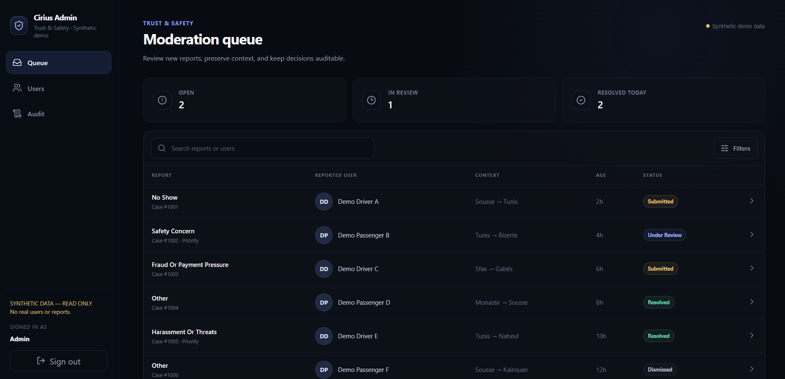](admin/01-moderation-queue.png)

### Case details

Report context, ride and booking details, related accounts and controlled conversation access interface.

[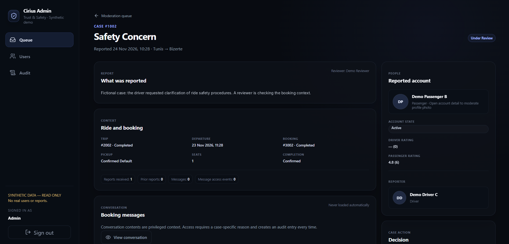](admin/02-report-case.png)

### User management

Search and review of fictional accounts and factual report counts.

[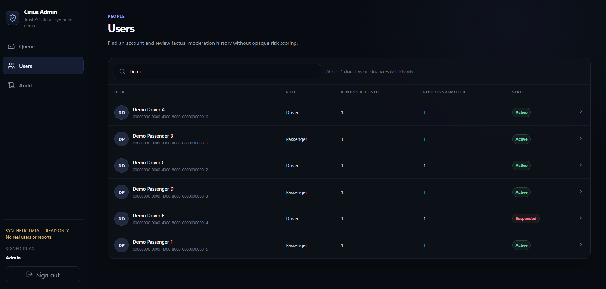](admin/03-user-management.png)

### Account details

Account history, reputation and moderation state.

[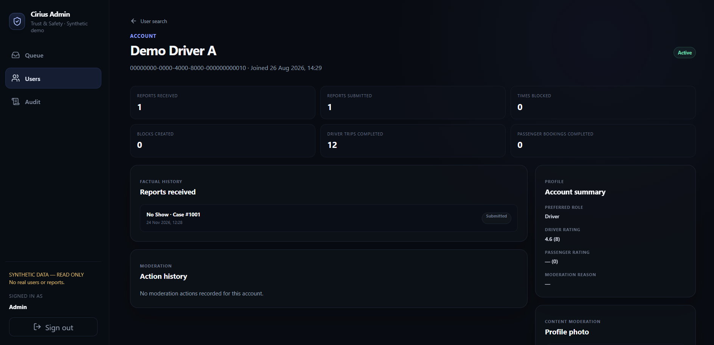](admin/04-account-details.png)

### Audit history

Illustrative moderation decisions and audit event context.

[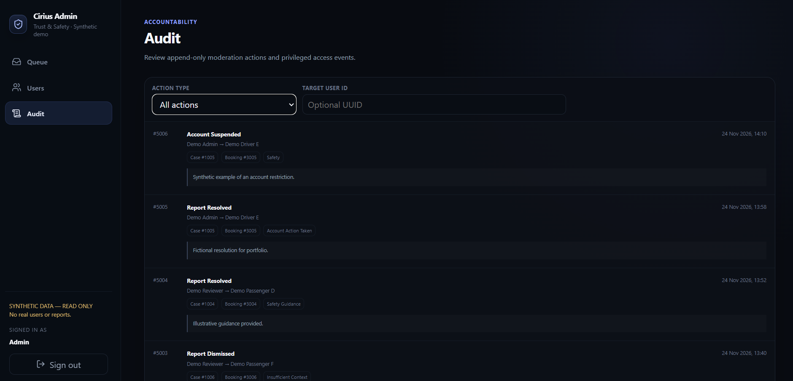](admin/05-audit-history.png)

---

These captures are portfolio evidence of the interface, not a release certification or evidence of real-user activity. Commercial application source remains private.
